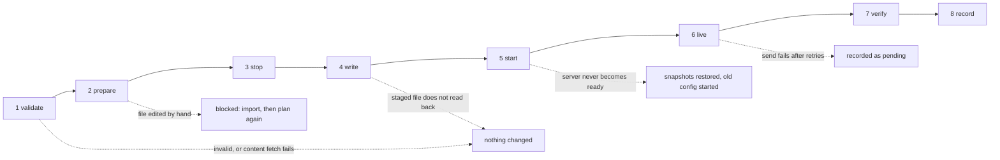

# Applying changes

An adapter turns a values document into a plan, shows it, then runs it in eight phases. Every failure ends in a known state, and only a failed live send leaves a change partly applied. The reference planner is `gsc_plan.py`.

Files are staged and committed together, after each is verified with a strict parser, so a server never reads half a configuration.

**When a write takes effect.** Each change takes the least disruptive route that works: the later of the setting's `apply` and its target's timing.

| Target | Takes effect | Notes |
| --- | --- | --- |
| `console`, `http` | Immediately | Only while running; `pendingWhileStopped` and `requiresRunning` writes are queued until it runs |
| `file` with `executes: onMapLoad` | Next map | CS:S `server.cfg` |
| `file`, `registry`, `args`, `prompts` | Restart | A stopped server picks them up when it next starts |
| `env` | Recreate | A container's environment is fixed when it is created |
| `manual` | When a person does it | Pending until confirmed; only when its `when` holds |
| Any, for a `worldCreate` setting | New worlds only | The plan says so; the current world keeps its value |

A restart applies only to the processes whose files changed. A target with `writeWhen: stopped` forces a stop before writing, as does a Wine registry edited offline.

**Players online.** When the plan needs a restart and players are connected, the adapter offers two options: restart now, or defer, where files are written and live changes sent now and the restart waits until the server is empty. Deferring is not offered when a file cannot be written while the server runs (Palworld), because then nothing can happen until it stops.

**Failure handling.**

- Validation or content fetch fails: nothing is changed.
- A file GSC manages was edited by hand since the last apply: the plan is blocked; import the file and plan again.
- A staged file does not read back: it is discarded and nothing is committed. Verification must use a strict parser; a lenient one let an unclosed quote through in testing.
- The server does not become ready: the snapshots and previous launch arguments are restored and the old configuration is started. If that also fails, the operator is alerted.
- A live send fails after retries: files stay committed; the setting is recorded as pending and applies at the next map or restart. Values sent with `sendWhen: changed` are not recorded as sent.

**Applied state.** After each run the adapter records the applied values, a hash of every file it wrote, digests of sent values, and pending items. The next plan diffs against this record and uses the hashes to detect hand edits.

One adapter runs at a time per server; a second waits for the lock rather than interleaving writes.
