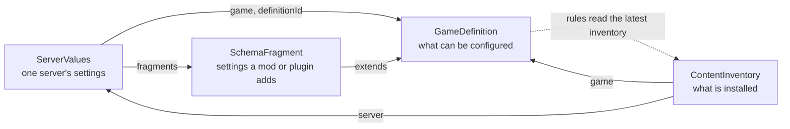

# Document kinds

Four documents make up a game's configuration; each arrow is a key that refers to another document.

The game definition's rules also read the latest inventory, so a rotation can be checked against what is installed.
