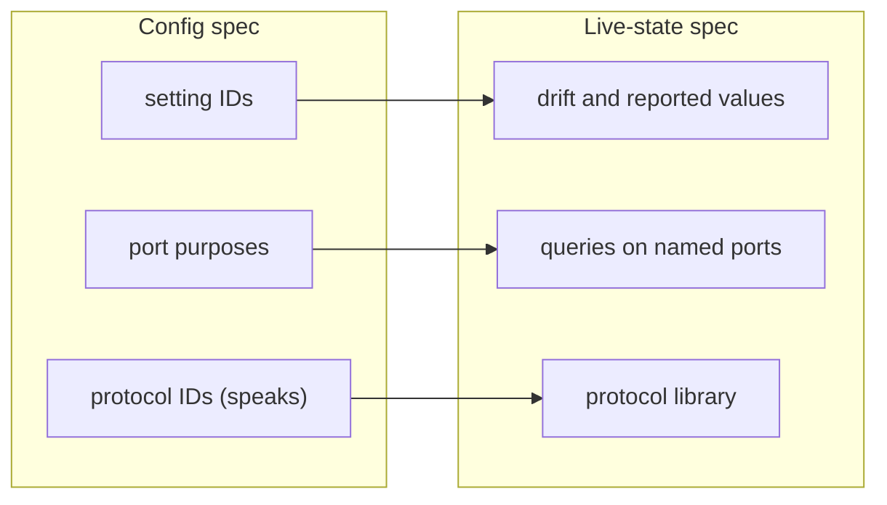

# Game Server Config Standard

:::caution Draft
This is draft 0.1. The format is still changing, and every example definition carries `# verify` notes for details that have not been checked against a real server.
:::

The config spec describes what a game server can be configured with, where each setting is written, and when a change takes effect. Live server state is a separate spec that builds on references the config spec defines.

| In the config spec | Out of the config spec |
| --- | --- |
| Typed settings schema, UI hints, validation | Installation, updates, process management (left to panels) |
| Values document for one server | Live state: players, current map, performance (separate spec) |
| Adapters that write values to files, args, env, console/RCON, HTTP APIs | Port allocation and firewall configuration (left to panels) |
| Port metadata: defaults, purpose, protocol, relationships |  |
| Query and admin protocol identifiers | Protocol behavior and payloads (live-state spec) |

**Format:** schemas, values documents and adapters are authored in YAML 1.2, validated with JSON Schema. JSON is an accepted equivalent serialization for tooling. Authoring rules: quote strings that look like booleans or numbers, and no custom tags. Anchors and aliases are allowed in game schemas and discouraged in values documents.

The vocabulary was developed against twelve [reference games](/games) (Counter-Strike: Source, Valheim, Quake III Arena, Freelancer, Starsiege: Tribes, Palworld, Satisfactory, Minecraft: Java Edition, Factorio, 7 Days to Die, Don't Starve Together and Terraria) and excerpts for ARK: Survival Evolved, Counter-Strike 2 and Arma 3. Anything this spec does not define is plain JSON Schema 2020-12.

## How this spec is organized

- **Foundations:** [conventions](./conventions.md) shared by every document, and the [document kinds](./document-kinds.md) and how they refer to each other.
- **Game definitions:** what a game can be configured with, from [settings](./definitions/settings.md) and [targets](./definitions/targets.md) to [scopes](./definitions/scopes.md), [content](./definitions/content.md) and [versioning](./definitions/versioning.md).
- **Server values:** one server's configuration, including [raw passthrough](./values/raw.md) and [secrets](./values/secrets.md).
- **Adapters:** how changes are [applied](./adapters/applying.md) and how existing configs are [imported](./adapters/importing.md).
- **Panels and hosting:** [permissions](./panels/permissions.md) and [distribution](./panels/distribution.md) of definitions through registries.
- **Project:** the [design coverage](./project/coverage.md) that tests the format, and the [roadmap](./project/roadmap.md).

## Boundary with the live-state spec

The live-state spec owns no game data of its own: it points at setting IDs, port purposes and protocol identifiers defined here, so one game definition package serves both specs.

Runtime values let a UI flag drift, such as a setting changed from the in-game console that no longer matches the config.

See the [live-state spec](/live-state).
